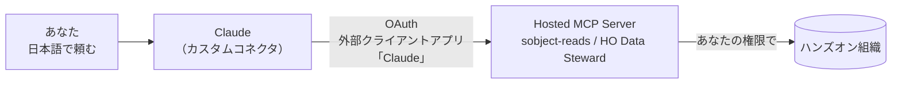

# 【実践】Hosted MCP Server で変わる現場のデータ運用！ — ハンズオン手順書

Salesforce World Tour Tokyo 2026（2026/11/19）のワークショップ
「Salesforce データ整備・可視化 体験ワークショップ」の手順書です。

- 当日のスライド: [Hosted MCP Server データ整備ワークショップ](https://docs.google.com/presentation/d/15npCY9T6a-DPF2KnRalCHNqW7wE7HqIU_-CZ1Xca6Xg/edit)
- パッケージのインストール URL: https://login.salesforce.com/packaging/installPackage.apexp?p0=04tgL000000fuKnQAI

> ※会社名・人名・数値はすべて架空のデータです。
> ※画面の名前は 2026年9月時点の情報です。リリースで変わることがあります。

---

## 目次

1. [今日のしくみ](#1-今日のしくみ)
2. [事前準備（管理者が最初に1回だけ）](#2-事前準備管理者が最初に1回だけ)
3. [当日の準備 — 4ステップ](#3-当日の準備--4ステップ)
4. [Claude のカスタムコネクタを作成して接続する](#4-claude-のカスタムコネクタを作成して接続する)
5. [ハンズオン — シナリオA・B・C](#5-ハンズオン--シナリオabc)
6. [検証 — 直す前・直すとき・直した後](#6-検証--直す前直すとき直した後)
7. [困ったときは](#7-困ったときは)
8. [自分の組織で使うときのポイント](#8-自分の組織で使うときのポイント)

---

## 1. 今日のしくみ

- **Hosted MCP Server** は Salesforce が用意する「AI の接続口」です。サーバの構築やインストールは不要です
- AI は**接続したあなたの権限**で動きます。AI にできることは、いつもの権限セット・項目レベルセキュリティ・共有設定で決まります
- 今日使う道具（MCP サーバ）は2つです

| MCP サーバ | 種類 | できること |
| --- | --- | --- |
| `sobject-reads`（標準） | 見る | スキーマ参照・SOQL・検索・集計 |
| `HO Data Steward`（カスタム） | 見る＋直す | 品質レポート、ベースラインとの差分、一括更新の**プレビュー → 承認 → 適用 → ロールバック**、取引先の重複統合 |

更新は必ず「調べる → 確認（まだ変わらない）→ あなたが OK → 反映 → 見直す」の順に進みます。
直してよい項目・件数の上限・練習用データ以外は触れない、といった制限は**道具の側**で止めています。

---

## 2. 事前準備（管理者が最初に1回だけ）

> **当日は講師側で準備済みです。** 自分の組織で再現するときの手順として載せています。

| # | やること | 内容 |
| --- | --- | --- |
| 01 | 外部クライアントアプリを確認 | Claude 用の外部クライアントアプリ `Claude` の接続ポリシーを確認する |
| 02 | AI 用の権限 | 接続ユーザーに「見るだけ」「直せる」の権限セットを割り当てる |
| 03 | MCP サーバを用意 | 標準サーバを有効化し、カスタムサーバにツールを登録する |
| 04 | Claude に登録 | 接続先を入れ、ログインして許可する（[4章](#4-claude-のカスタムコネクタを作成して接続する)） |

### 2-1. 外部クライアントアプリケーション「Claude」

Hosted MCP Server には、外部クライアントアプリケーション `Claude` を通して接続します。

- Claude に入力するコンシューマ鍵は講師が案内します（クライアントシークレットは不要）
- `設定 → 外部クライアントアプリケーションマネージャ → Claude → ポリシー` で、接続を許可するユーザーを確認してください

### 2-2. 権限セットと接続ユーザー

| 権限セット | 対象 | できること |
| --- | --- | --- |
| `HO_Workshop_Admin` | 講師・メンター、準備画面を使う人 | 準備画面＋全ツール |
| `HO_MCP_ReadOnly` | 参加者・前半 | 参照系ツールのみ |
| `HO_MCP_Editor` | 参加者・後半 | 更新系ツール（削除は取引先統合のための取引先のみ） |

- 権限セットは権限を**足すだけ**です。元のプロファイルが広いと AI も広く動きます。MCP で接続するユーザーのプロファイルは「最低限のアクセス - Salesforce」が推奨です
- **管理者で接続しない**でください。権限セットに関係なく、すべてのデータを見て直せてしまいます

### 2-3. MCP サーバの有効化とカスタムサーバの作成

1. `設定 → API カタログ → MCP サーバ` → `sobject-reads` を開いて**有効化**
2. 「カスタムサーバ」タブ → **新規**
   - 表示名: `HO Data Steward` ／ API 名: `ho_data_steward`
   - 説明: 「ハンズオン用データの品質調査と、プレビュー・承認・ロールバック付きの一括更新」
3. 「ツールを追加」→ 種別「Apex アクション」で次の6つを追加し、有効化

   | ツール | 種別 |
   | --- | --- |
   | `HO: データ品質レポート（参照のみ）` | 見る |
   | `HO: ベースラインとの差分（参照のみ）` | 見る |
   | `HO: 一括更新プレビュー（変更なし）` | 確認（データは変わらない） |
   | `HO: 一括更新の適用` | 直す |
   | `HO: 一括更新のロールバック` | 直す（元に戻す） |
   | `HO: 取引先の重複統合` | 既定は影響確認のみ（dryRun） |

4. 各サーバの詳細ページで**サーバ URL をコピー**しておきます

| サーバ | URL |
| --- | --- |
| `sobject-reads`（本番・Developer Edition） | `https://api.salesforce.com/platform/mcp/v1/platform/sobject-reads` |
| `sobject-reads`（Sandbox・スクラッチ組織） | `https://api.salesforce.com/platform/mcp/v1/sandbox/sobject-reads` |
| `HO Data Steward` | カスタムサーバの詳細ページに表示される URL |

---

## 3. 当日の準備 — 4ステップ

| # | やること | 操作 |
| --- | --- | --- |
| 01 | パッケージを入れる | 配布 URL から「**管理者のみ**」でインストール |
| 02 | 権限セットを割り当て | `設定 → ユーザー → 権限セットの割り当て`（名前はメンターが案内します） |
| 03 | 練習用データを作る | アプリ「HO MCPハンズオン」→「ハンズオン準備」→「**テストデータを生成 / 初期状態に戻す**」 |
| 04 | Claude とつなぐ | Claude の `設定 → コネクタ` → カスタムコネクタを追加（[4章](#4-claude-のカスタムコネクタを作成して接続する)） |

### 01. パッケージを入れる

インストール URL:

https://login.salesforce.com/packaging/installPackage.apexp?p0=04tgL000000fuKnQAI

「管理者のみインストール」を選んで「インストール」を押し、完了メールが届くまで待ちます。

### 03. 練習用データを作る

「テストデータを生成 / 初期状態に戻す」を押すと、次の「荒れた」データが作られます。何度押しても同じ内容に戻ります。

| オブジェクト | 件数 | 仕込んである「荒れ」 |
| --- | --- | --- |
| 商品 | 34 | 商品コードの規則違反・重複 |
| 取引先 | 56 | 法人格のゆれ・重複16件 |
| 取引先責任者 | 136 | メール空欄・ドメイン誤り |
| リード | 120 | 会社名のゆれ・重複 |
| 商談 | 260 | 金額なし・失注理由なし |
| 活動（ToDo） | 1,910 | 電話・メール・訪問 |

「**直してはいけない**」レコードも仕込んであります。AI の案をうのみにしないでください。

---

## 4. Claude のカスタムコネクタを作成して接続する

claude.ai（ブラウザ）と Claude Desktop のどちらでも同じ手順です。コネクタはアカウントに保存されるため、一方で追加すればもう一方でも使えます。
**`sobject-reads` と `HO Data Steward` の2つ**を、それぞれ別のコネクタとして追加します。

### 4-1. 用意するもの

| 項目 | 値 |
| --- | --- |
| リモート MCP サーバの URL | [2-3](#2-3-mcp-サーバの有効化とカスタムサーバの作成) でコピーしたサーバ URL |
| OAuth Client ID | 外部クライアントアプリ `Claude` のコンシューマ鍵（講師が案内します） |
| OAuth Client Secret | 空欄のまま（PKCE を使うため不要） |
| Salesforce のユーザー | ハンズオン組織のユーザー（MCP 用の権限セットを割り当てたもの） |

### 4-2. コネクタを追加する

1. Claude の左下のアカウントメニュー → **設定** → **コネクタ** を開く
2. **カスタムコネクタを追加** をクリック
3. 次のように入力する

   | 入力欄 | 1つ目 | 2つ目 |
   | --- | --- | --- |
   | 名前 | `Salesforce sobject-reads` | `Salesforce HO Data Steward` |
   | リモート MCP サーバーの URL | `sobject-reads` のサーバ URL | `HO Data Steward` のサーバ URL |
   | 詳細設定 → OAuth Client ID | コンシューマ鍵 | コンシューマ鍵（同じもの） |
   | 詳細設定 → OAuth Client Secret | 空欄 | 空欄 |

4. **追加** をクリック

> Team / Enterprise プランでは、オーナーが先に `組織の設定 → コネクタ` でカスタムコネクタを追加し、
> メンバーはそれぞれ「連携」して自分の Salesforce ユーザーでログインします。

### 4-3. Salesforce にログインして許可する

1. 追加したコネクタの **連携（Connect）** をクリック
2. Salesforce のログイン画面が開くので、**ハンズオン組織のユーザー**でログイン（Sandbox・スクラッチ組織の場合は「カスタムドメインを使用」から組織のドメインを入力）
3. 外部クライアントアプリ `Claude` へのアクセス許可画面で **許可** をクリック
4. Claude の画面に戻り、コネクタが「連携済み」になっていることを確認
5. 2つ目のコネクタでも同じ操作を行う

### 4-4. チャットで使えるようにする

1. 新しいチャットを開き、入力欄の **＋（検索とツール）** メニューで2つのコネクタをオンにする
2. コネクタ設定画面で、ツールごとの許可を確認する
   - 参照系（品質レポート・差分・SOQL など）: 「常に許可」でよい
   - 更新系（**一括更新の適用・ロールバック・取引先の重複統合**）: 「**承認が必要**」にしておくと、実行のたびに Claude が確認してくれます
3. 動作確認として「接続している Salesforce のユーザー名と、取引先の件数を教えて」と頼み、56件と返ってくれば準備完了です

> 接続は最初の1回だけです。途中でつなぎ直しはしません。
> 後半で権限セット `HO_MCP_Editor` を追加しても、つなぎ直す必要はありません。

### 4-5. 接続でつまずいたとき

| 症状 | 確認すること |
| --- | --- |
| ログイン後に `OAUTH_APPROVAL_ERROR` やアクセス拒否 | ECA `Claude` のポリシーで、そのユーザーが許可されているか |
| `redirect_uri_mismatch` | ECA のコールバック URL が `https://claude.ai/api/mcp/auth_callback` か |
| `invalid_client_id` | Claude に入れたコンシューマ鍵が正しいか（前後の空白に注意） |
| 接続できたがツールが出てこない | API カタログでサーバが有効か／カスタムサーバのツールが有効か |
| ツールが `No such column` などのエラー | 接続ユーザーに `HO_MCP_ReadOnly` / `HO_MCP_Editor` が付いているか |
| 本番用 URL で Sandbox に接続できない | Sandbox・スクラッチ組織は URL の `/v1/platform/` を `/v1/sandbox/` に変える |

---

## 5. ハンズオン — シナリオA・B・C

### 進め方

| # | ステップ | 内容 |
| --- | --- | --- |
| 01 | 調べる | シナリオA・B で、何が荒れているかを調べる |
| 02 | 分析する | シナリオC で、分析とグラフ作り |
| 03 | 直す | 修正案を確認してから反映する |

### AI への頼み方 3つのコツ

1. 最初に「**まだ何も変更しないで**」と伝える
2. 「**なぜそう判断したか**」も書かせる
3. 分からないものは、**空欄のまま残させる**

### シナリオA マスタオブジェクトの整備

- **ゴール**: 表記ゆれ・重複・命名規則違反を AI に調べさせ、まとめて直す
- **対象**: 取引先 56件／商品 34件
- **命名規則**: 「株式会社」と正式に書く／カナは全角／英数字は半角／余分な空白なし

プロンプト例:

1. 「取引先の表記ゆれと重複候補を、根拠つきで一覧にして。まだ何も変更しないで」
2. 「法人番号が一致するものだけ統合候補に。違うもの・支店らしいものは理由つきで分けて」
3. 「命名規則違反の修正案をプレビューして」→「5行目は除外して適用して」
4. 「最初の状態との差分を見せて」→「さっきの変更を元に戻して」

> **ふりかえりの観点**: 名前が似ていても、法人番号が違えば別の会社です。支店や法人格が分からないものは、AI ではなく人が判断します。

### シナリオB 足りないデータの抽出と補完

- **ゴール**: 空欄のレコードを探し、埋めるためのリストを作る
- **見る項目の例**: 業種・電話番号／メール／金額・失注理由／リードソース
- **埋めるときの原則**: 根拠のない値（金額など）は AI に推測させず、営業への確認リストにする

プロンプト例:

1. 「提案/見積以降なのに金額が空の商談を、担当営業ごとに一覧にして。CSV でも出して」
2. 「失注理由が空の商談に、メモの文面から理由の候補を出して。分からないものは空のまま、プレビューまで」

CSV でもらえば、そのまま営業への依頼に使えます。

### シナリオC 営業データの分析と可視化

- **ゴール**: パイプライン・失注理由・活動量を分析し、ダッシュボードで見える化する
- **対象**: 商談 260件／活動 1,910件／担当営業 6名
- **分析の前に確かめる**: 重複した取引先にも商談があります。統合前に集計すると数字が割れます

プロンプト例:

1. 「直近12か月の担当営業別の受注率・平均受注額・活動数を、ダッシュボード形式で表示して」
2. 「失注理由の内訳を商材別にダッシュボードに追加して。空欄は件数を書いて除外、示唆も3つ」
3. 「完了予定日が今後3か月のパイプラインを、フェーズ別にダッシュボードに追加して」

> **ふりかえりの観点**: 活動量と受注率は比例するとは限りません。1人あたりの件数は少ないので、断定しすぎないことも大切です。

答え合わせ（仕込んだ「荒れ」と期待する示唆）はメンター用の [docs/facilitator-guide.md](docs/facilitator-guide.md) にあります。

---

## 6. 検証 — 直す前・直すとき・直した後

| タイミング | 確認すること |
| --- | --- |
| 直す前 | 修正案の一覧で変化を確認する。統合は「何が起きるか」だけ先に確認する |
| 直すとき | プレビューから60分を過ぎた案は反映されない。決めた項目・件数を超えたら止まる |
| 直した後 | 最初の状態との差分を確認する。間違えたら、まとめて元に戻せる |

「元に戻せる」から、安心して任せられます。

---

## 7. 困ったときは

| こんなとき | こうする |
| --- | --- |
| やり直したい | 「ハンズオン準備」→「初期状態に戻す」を押す |
| エラーが出る | 権限セットをメンターと確認する |
| 「許可されていない項目」 | 対象外の項目です。そういう設計です |
| 「Conflict（競合）」 | プレビュー（確認）からやり直す |
| 「有効期限切れ」 | プレビュー（確認）からやり直す |
| Claude とつながらない | [4-5](#4-5-接続でつまずいたとき) を確認する |

手が止まったら、手を挙げてメンターを呼んでください。

---

## 8. 自分の組織で使うときのポイント

1. AI 用の権限を作り「**見るだけ**」から始める
2. 「直せる」は必要な人に必要な間だけ
3. 必ず「**確認 → 人が OK → 反映**」
4. 誰が何を変えたか、あとで追える
5. 統合・削除は人が画面で行う
6. 本番の前に **Sandbox** で試す（Developer Edition は先に動作確認）

> 範囲は権限で決める。更新は道具で止める。最後は人が判断する。
