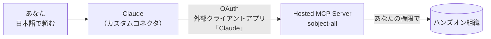

# 【実践】Hosted MCP Server で変わる現場のデータ運用！ — ハンズオン手順書

Salesforce World Tour Tokyo 2026（2026/11/19）のワークショップ
「Salesforce データ整備・可視化 体験ワークショップ」の手順書です。

- 自社の組織で設定する手順: [docs/own-org-setup.md](docs/own-org-setup.md)
- 当日のスライド: [Hosted MCP Server データ整備ワークショップ](https://docs.google.com/presentation/d/15npCY9T6a-DPF2KnRalCHNqW7wE7HqIU_-CZ1Xca6Xg/edit)
- パッケージのインストール: 自分の組織の URL の末尾に `packaging/installPackage.apexp?p0=04tgL000000i9vdQAA` を付けて開く（[手順](#01-パッケージを入れる)）

> ※会社名・人名・数値はすべて架空のデータです。
> ※画面の名前は 2026年9月時点の情報です。リリースで変わることがあります。

### Developer Edition をまだ用意していない方へ

ハンズオンは、無料の **Salesforce Developer Edition** 組織で行います。まだ持っていない場合は、最初に次の手順で用意してください（数分かかります）。

1. [https://developer.salesforce.com/signup](https://developer.salesforce.com/signup) を開き、名前・メールアドレス・ユーザー名などを入力して申し込む
   - ユーザー名はメールアドレスの形式で、**Salesforce 全体で重複しないもの**にします（例: `yourname@awtt-handson.example`）。実在のメールアドレスでなくてもかまいません
   - メールアドレスには、確認メールを受け取れる自分のアドレスを入れます
2. 届いたメールのリンクを開き、パスワードを設定してログインする
   - メールが届くまで数分かかることがあります。届かないときは迷惑メールフォルダも確認してください
3. ログインできたら、[3. 当日の準備](#3-当日の準備--4ステップ) の「01. パッケージを入れる」へ進む

> 会社で使っている本番組織や Sandbox ではなく、**ハンズオン用に作った Developer Edition** で進めてください。

### 無料プランの方へ — 使用量の上限に注意

Claude の無料プランは使用量に上限があり、ハンズオンの途中で使い切る可能性があります。

1. **モデルは Haiku を選ぶ**: チャットの入力欄のモデル選択で Haiku に切り替えると、使用量を節約できます
2. **上限に達したら、前の画面を見て流れを追う**: 講師の画面で続きを確認してください
3. **続きは家で**: 上限が戻ったら、この手順書を見ながら続きを進めてください。練習用データは「ハンズオン準備」→「テストデータを生成 / 初期状態に戻す」でいつでも作り直せます
4. **カスタムコネクタは1つまで**: 無料プランで追加できるカスタムコネクタは1つだけです。すでに別のカスタムコネクタがある場合は、`設定 → コネクタ` で**削除してから** [4章](#4-claude-のカスタムコネクタを作成して接続する) の手順で追加してください

---

## 目次

1. [今日のしくみ](#1-今日のしくみ)
2. [事前準備（管理者が最初に1回だけ）](#2-事前準備管理者が最初に1回だけ)
3. [当日の準備 — 4ステップ](#3-当日の準備--4ステップ)
4. [Claude のカスタムコネクタを作成して接続する](#4-claude-のカスタムコネクタを作成して接続する)
5. [ハンズオン — シナリオA・B・C](#5-ハンズオン--シナリオabc)
6. [検証 — 直す前・直すとき・直した後](#6-検証--直す前直すとき直した後)
7. [困ったときは](#7-困ったときは)
8. [自分の組織で使うときのポイント](#8-自分の組織で使うときのポイント)

---

## 1. 今日のしくみ



- **Hosted MCP Server** は Salesforce が用意する「AI の接続口」です。サーバの構築やインストールは不要です
- AI は**接続したあなたの権限**で動きます。AI にできることは、いつもの権限セット・項目レベルセキュリティ・共有設定で決まります
- 今日使う道具（MCP サーバ）は Salesforce 標準の `sobject-all` の1つだけです

| MCP サーバ | 種類 | できること |
| --- | --- | --- |
| `sobject-all`（標準） | 見る＋直す＋消す | スキーマ参照・SOQL・検索に加え、レコードの作成・更新・削除（取引先の統合に必要） |

更新は必ず「調べる → 修正案を表で確認（まだ変えない）→ あなたが OK → 反映 → 見直す」の順に進みます。
`sobject-all` は何でも直せてしまうので、Claude のツール許可で**作成・更新・削除を「承認が必要」**にして、反映の前に必ず確認します（[4-4](#4-4-チャットで使えるようにする)）。
間違えたときは、「ハンズオン準備」→「テストデータを生成 / 初期状態に戻す」で練習用データをいつでも元に戻せます。

---

## 2. 事前準備（管理者が最初に1回だけ）

> 外部クライアントアプリ `Claude` はパッケージに含まれているため、準備は不要です。
> **[2-3](#2-3-mcp-サーバの有効化) の MCP サーバの有効化は、各自の組織で当日に行ってください**（講師側では準備できません）。

| # | やること | 内容 |
| --- | --- | --- |
| 01 | 外部クライアントアプリを確認 | Claude 用の外部クライアントアプリ `Claude` の接続ポリシーを確認する |
| 02 | AI 用の権限 | 接続ユーザーに「見るだけ」「直せる」の権限セットを割り当てる |
| 03 | MCP サーバを用意 | 標準サーバ `sobject-all` を有効化する |
| 04 | Claude に登録 | 接続先を入れ、ログインして許可する（[4章](#4-claude-のカスタムコネクタを作成して接続する)） |

### 2-1. 外部クライアントアプリケーション「Claude」

Hosted MCP Server には、外部クライアントアプリケーション `Claude` を通して接続します。

- Claude に入力するコンシューマ鍵（OAuth クライアント ID）は全員共通で、[4-1](#4-1-用意するもの) に載せています。コピーして貼り付けてください（クライアントシークレットは不要）
- `設定 → 外部クライアントアプリケーションマネージャ → Claude → ポリシー` で、接続を許可するユーザーを確認してください

### 2-2. 権限セットと接続ユーザー

> **今回のハンズオンでは時間短縮のため、権限セットは割り当てず、システム管理者のユーザーでそのまま接続・実行します。**
> 下の権限セットは、自分の組織で本格的に使うときの設計例です。

| 権限セット | 対象 | できること |
| --- | --- | --- |
| `HO_Workshop_Admin` | 講師・メンター、準備画面を使う人 | 準備画面＋全ツール |
| `HO_MCP_ReadOnly` | 参加者・前半 | 参照系ツールのみ |
| `HO_MCP_Editor` | 参加者・後半 | 更新系ツール（削除は取引先統合のための取引先のみ） |

- 権限セットは権限を**足すだけ**です。元のプロファイルが広いと AI も広く動きます。MCP で接続するユーザーのプロファイルは「最低限のアクセス - Salesforce」が推奨です
- 本来は**管理者で接続しない**でください。権限セットに関係なく、すべてのデータを見て直せてしまいます（今回は練習用組織のため例外としています）

### 2-3. MCP サーバの有効化

1. `設定 → API カタログ → MCP サーバ` → `sobject-all` を開いて**有効化**
2. **自分の組織**の `sobject-all` の詳細ページに表示されている**サーバ URL をコピー**しておきます

> サーバ URL は、Claude のカスタムコネクタの「リモート MCP サーバーの URL」に入力します。
> 他の人の URL や資料のサンプル URL ではなく、**自分の組織の詳細ページに表示された URL** を使ってください。

---

## 3. 当日の準備 — 4ステップ

| # | やること | 操作 |
| --- | --- | --- |
| 01 | パッケージを入れる | 配布 URL から「**管理者のみ**」でインストール |
| 02 | システム管理者で進める | 今回は権限セットの割り当ては不要です。パッケージを入れたシステム管理者のユーザーのまま進めます |
| 03 | 練習用データを作る | アプリ「HO MCPハンズオン」→「ハンズオン準備」→「**テストデータを生成 / 初期状態に戻す**」 |
| 04 | MCP サーバを有効化して Claude とつなぐ | `設定 → API カタログ → MCP サーバ` で `sobject-all` を有効化し、サーバ URL をコピー（[2-3](#2-3-mcp-サーバの有効化)）→ Claude の `設定 → コネクタ` → カスタムコネクタを追加（[4章](#4-claude-のカスタムコネクタを作成して接続する)） |

### 01. パッケージを入れる

**おすすめ: 自分の組織の URL から開く**

ハンズオン組織にログインした状態で、ブラウザのアドレスバーにある**自分の組織のホームの URL** の末尾（`.com/` の後ろ）に、次の文字列を付けて開きます。

```text
packaging/installPackage.apexp?p0=04tgL000000i9vdQAA
```

例（`orgfarm-xxxxxxxxxx-dev-ed` の部分は自分の組織のものに置き換え）:

```text
https://orgfarm-xxxxxxxxxx-dev-ed.develop.lightning.force.com/packaging/installPackage.apexp?p0=04tgL000000i9vdQAA
```

- ログインし直す必要がありません
- いまログインしている組織にインストールされるので、**別の組織（本番組織など）に誤ってインストールする心配がありません**

共通のインストール URL（ログイン画面から開く方法）もありますが、ログインし直しが必要で、別の組織に入れてしまうおそれがあるため、上の方法をおすすめします。

https://login.salesforce.com/packaging/installPackage.apexp?p0=04tgL000000i9vdQAA

インストール画面が開いたら、「管理者のみインストール」を選んで「インストール」を押し、完了メールが届くまで待ちます。

### 03. 練習用データを作る

「テストデータを生成 / 初期状態に戻す」を押すと、次の「荒れた」データが作られます。何度押しても同じ内容に戻ります。

| オブジェクト | 件数 | 仕込んである「荒れ」 |
| --- | --- | --- |
| 商品 | 34 | 商品コードの規則違反・重複 |
| 取引先 | 56 | 法人格のゆれ・重複16件 |
| 取引先責任者 | 136 | メール空欄・ドメイン誤り |
| リード | 120 | 会社名のゆれ・重複 |
| 商談 | 260 | 金額なし・失注理由なし |
| 活動（ToDo） | 646 | 電話・メール・訪問 |

「**直してはいけない**」レコードも仕込んであります。AI の案をうのみにしないでください。

---

## 4. Claude のカスタムコネクタを作成して接続する

claude.ai（ブラウザ）と Claude Desktop のどちらでも同じ手順です。コネクタはアカウントに保存されるため、一方で追加すればもう一方でも使えます。
**`sobject-all` を1つ**、コネクタとして追加します。

### 4-1. 用意するもの

| 項目 | 値 |
| --- | --- |
| リモート MCP サーバの URL | [2-3](#2-3-mcp-サーバの有効化) で**自分の組織**の詳細ページからコピーした `sobject-all` のサーバ URL |
| OAuth クライアント | Claude の画面で「**独自の OAuth クライアントを使用する**」を選ぶ（「Claude の公開アイデンティティを使用」「自動的に登録」は選ばない） |
| OAuth クライアント ID | 下のコンシューマ鍵（全員共通） |
| OAuth クライアントシークレット（任意） | 空欄のまま（PKCE を使うため不要） |
| Salesforce のユーザー | ハンズオン組織のシステム管理者ユーザー（今回は権限セットの割り当て不要） |

OAuth クライアント ID（外部クライアントアプリ `Claude` のコンシューマ鍵）:

```text
3MVG9dAEux2v1sLs2S9rOLjectsSJLrg6wbbnd46dWlZb6t0M.B2vZweYe_DtAya3Eyg9VB0bpndkGaiQu3gq
```

> この値は PKCE を使う公開クライアントの ID で、秘密情報ではありません。これだけでは組織にアクセスできず、接続には各自の Salesforce ログインと許可が必要です。

### 4-2. コネクタを追加する

> **無料プランの方へ**: カスタムコネクタは1つしか追加できません。すでに別のカスタムコネクタがある場合は、先に `設定 → コネクタ` から削除してください。

1. Claude の左下のアカウントメニュー → **設定** → **コネクタ** を開く
2. **カスタムコネクタを追加** をクリック
3. 次のように入力する

   | 入力欄 | 入力する値 |
   | --- | --- |
   | 名前 | `Salesforce sobject-all` |
   | リモート MCP サーバーの URL | 自分の組織の `sobject-all` のサーバ URL |
   | OAuth クライアント | 「独自の OAuth クライアントを使用する」を選択 |
   | OAuth クライアント ID | [4-1](#4-1-用意するもの) のコンシューマ鍵を貼り付け |
   | OAuth クライアントシークレット（任意） | 空欄 |

   > Salesforce は自動登録（DCR）に対応していないため、「自動的に登録」などを選ぶと連携に失敗します。
   > **「独自の OAuth クライアントを使用する」を選び、OAuth クライアント ID を必ず貼り付け**てください。

4. **追加** をクリック

> Team / Enterprise プランでは、オーナーが先に `組織の設定 → コネクタ` でカスタムコネクタを追加し、
> メンバーはそれぞれ「連携」して自分の Salesforce ユーザーでログインします。

### 4-3. Salesforce にログインして許可する

1. 追加したコネクタの **連携（Connect）** をクリック
2. Salesforce のログイン画面が開くので、**ハンズオン組織（Developer Edition）のシステム管理者ユーザー**でログイン
3. 外部クライアントアプリ `Claude` へのアクセス許可画面で **許可** をクリック
4. Claude の画面に戻り、コネクタが「連携済み」になっていることを確認

### 4-4. チャットで使えるようにする

1. 新しいチャットを開き、入力欄の **＋（検索とツール）** メニューで `Salesforce sobject-all` をオンにする
2. コネクタ設定画面で、ツールごとの許可を確認する
   - 参照系（スキーマ参照・SOQL・検索など）: 「常に許可」でよい
   - **作成・更新・削除**: 必ず「**承認が必要**」にする。実行のたびに Claude が確認を求めるので、内容を見てから許可します
3. 動作確認として「接続している Salesforce のユーザー名と、取引先の件数を教えて」と頼み、56件と返ってくれば準備完了です

> 接続は最初の1回だけです。途中でつなぎ直しはしません。

### 4-5. 接続でつまずいたとき

| 症状 | 確認すること |
| --- | --- |
| ログイン後に `OAUTH_APPROVAL_ERROR` やアクセス拒否 | ECA `Claude` のポリシーで、そのユーザーが許可されているか |
| `redirect_uri_mismatch` | ECA のコールバック URL が `https://claude.ai/api/mcp/auth_callback` か |
| `invalid_client_id` | Claude に入れたコンシューマ鍵が正しいか（前後の空白に注意） |
| 接続できたがツールが出てこない | API カタログで `sobject-all` が有効か |
| ツールが `No such column` などのエラー | システム管理者のユーザーで接続しているか |
| 接続できない・別の組織につながる | コネクタの URL が**自分の組織**のサーバ詳細ページに表示された URL か（サンプルや他の人の URL を使っていないか） |
| `invalid_client_id` 以外の OAuth エラーで連携できない | 「独自の OAuth クライアントを使用する」を選び、OAuth クライアント ID を貼り付けたか |

---

## 5. ハンズオン — シナリオA・B・C

### 進め方

| # | ステップ | 内容 |
| --- | --- | --- |
| 01 | 調べる | シナリオA・B で、何が荒れているかを調べる |
| 02 | 分析する | シナリオC で、分析とグラフ作り |
| 03 | 直す | 修正案を確認してから反映する |

### AI への頼み方 3つのコツ

1. 最初に「**まだ何も変更しないで**」と伝える
2. 「**なぜそう判断したか**」も書かせる
3. 分からないものは、**空欄のまま残させる**

### シナリオA マスタオブジェクトの整備

- **ゴール**: 表記ゆれ・重複・命名規則違反を AI に調べさせ、まとめて直す
- **対象**: 取引先 56件／商品 34件
- **命名規則**: 「株式会社」と正式に書く／カナは全角／英数字は半角／余分な空白なし
- **今回のデータの工夫**: 統合される側の重複取引先には、商談・取引先責任者などの関連レコードを付けていません。統合しても関連レコードの付け替えが起きず、無料プランでも使用量を抑えて試せます（実際の組織では、統合で関連レコードが統合先に付け替わります）

プロンプト例:

1. 「取引先の重複候補を調べて、上位10件を表にして。まだ何も変更しないで」
2. 「法人番号が一致するものだけ統合候補に。違うもの・支店らしいものは理由を一言で」
3. 「命名規則違反の修正案を10件、表に。更新はまだ」→「5行目以外を更新」
4. 「さっき更新した取引先の今の名前を表にして」（間違えたら「初期状態に戻す」でやり直し）

> **ふりかえりの観点**: 名前が似ていても、法人番号が違えば別の会社です。支店や法人格が分からないものは、AI ではなく人が判断します。

### シナリオB 足りないデータの抽出と補完

- **ゴール**: 空欄のレコードを探し、埋めるためのリストを作る
- **見る項目の例**: 業種・電話番号／メール／金額・失注理由／リードソース
- **埋めるときの原則**: 根拠のない値（金額など）は AI に推測させず、営業への確認リストにする

プロンプト例:

1. 「提案/見積以降なのに金額が空の商談を、担当営業ごとの件数で表にして」
2. 「失注理由が空の商談に、メモから理由の候補を出して表にして。分からないものは空のまま、まだ更新しないで」

一覧や CSV は、必要になったときだけ頼みます（出力が長いと使用量が増えます）。ダッシュボードも、表を作ってから最後に1回だけまとめるのがおすすめです。

### シナリオC 営業データの分析と可視化

- **ゴール**: パイプライン・失注理由・活動量を分析し、ダッシュボードで見える化する
- **対象**: 商談 260件／活動 646件／担当営業 6名
- **分析の前に確かめる**: 失注理由の空欄は、シナリオBで補完してから集計すると担当営業ごとの傾向が見えます

プロンプト例:

1. 「直近12か月の担当営業別の受注率・平均受注額・活動数を表にして」
2. 「失注理由の内訳を担当営業別に表にして。空欄は件数だけ書いて除外して」
3. 「完了予定日が今後3か月のパイプラインを、フェーズ別の件数と金額で表にして」
4. 「ここまでの3つの表を、1つのダッシュボードにまとめて」

> **ふりかえりの観点**: 活動量と受注率は比例するとは限りません。1人あたりの件数は少ないので、断定しすぎないことも大切です。

答え合わせ（仕込んだ「荒れ」と期待する示唆）はメンター用の [docs/facilitator-guide.md](docs/facilitator-guide.md) にあります。

---

## 6. 検証 — 直す前・直すとき・直した後

| タイミング | 確認すること |
| --- | --- |
| 直す前 | 修正案を表で確認する（「まだ更新しないで」と頼む）。統合は「何が起きるか」だけ先に確認する |
| 直すとき | Claude の承認画面で、対象のレコードと値を見てから許可する |
| 直した後 | 更新後の値を表で確認する。間違えたら「初期状態に戻す」でやり直す |

「承認してから反映する」「いつでも初期状態に戻せる」から、安心して試せます。

---

## 7. 困ったときは

| こんなとき | こうする |
| --- | --- |
| やり直したい | 「ハンズオン準備」→「初期状態に戻す」を押して、ごみ箱を空にする |
| エラーが出る | システム管理者のユーザーで接続しているか確認する |
| Claude が承認を求めてきた | 対象のレコードと値を確認してから許可する（違っていたら拒否する） |
| Claude とつながらない | [4-5](#4-5-接続でつまずいたとき) を確認する |

手が止まったら、手を挙げてメンターを呼んでください。

---

## 8. 自分の組織で使うときのポイント

1. AI 用の権限を作り「**見るだけ**」から始める
2. 「直せる」は必要な人に必要な間だけ
3. 必ず「**確認 → 人が OK → 反映**」
4. 誰が何を変えたか、あとで追える
5. 統合・削除は人が画面で行う
6. 本番の前に **Developer Edition** で試す（Sandbox は claude.ai から接続すると認証に失敗する報告があり、動作を確認できていません）

> 範囲は権限で決める。更新は道具で止める。最後は人が判断する。

自社の組織で Hosted MCP Server と Claude をつなぐ手順（外部クライアントアプリの作り方、権限セットを持つ人だけに接続を限定する方法、MCP サーバの有効化、Claude 側の設定）は [docs/own-org-setup.md](docs/own-org-setup.md) にまとめています。
