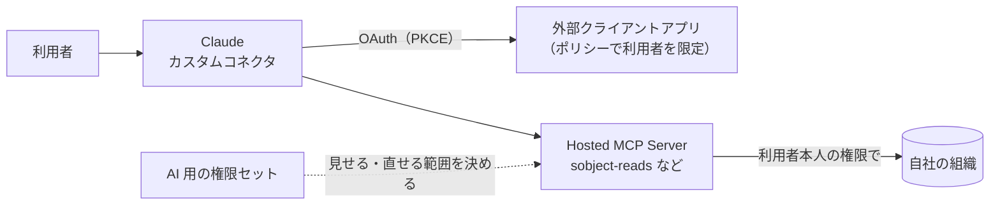

# 自社の組織で Hosted MCP Server を設定する手順

ハンズオンの後に、**自分の会社の Salesforce 組織**で Hosted MCP Server と Claude をつなぎたい人向けの手順です。
ハンズオンではパッケージに含まれた設定を使いましたが、ここではすべて自分で作ります。

> ※画面の名前は 2026年9月時点の公開情報をもとにしています。リリースで変わることがあります。
> ※最初は必ず **Sandbox** で試し、問題がないことを確かめてから本番組織に設定してください。

---

## 全体の流れ

| # | やること | 場所 |
| --- | --- | --- |
| 1 | 外部クライアントアプリケーションを作る | Salesforce の設定 |
| 2 | AI 用の権限セットを作り、使う人にだけ割り当てる | Salesforce の設定 |
| 3 | 外部クライアントアプリのポリシーで、権限セットを持つ人だけ接続できるようにする | Salesforce の設定 |
| 4 | MCP サーバを有効化する | Salesforce の設定（API カタログ） |
| 5 | Claude にカスタムコネクタを追加して接続する | Claude の設定 |
| 6 | ツールごとの許可を設定する | Claude の設定 |

---

## 1. 外部クライアントアプリケーションを作る

Hosted MCP Server には、従来の「接続アプリケーション」ではなく、**外部クライアントアプリケーション（External Client App）**で接続します。

1. `設定 → 外部クライアントアプリケーションマネージャ → 新規外部クライアントアプリケーション`
2. 基本情報を入力する
   - 外部クライアントアプリケーション名: 例 `Claude MCP`
   - 連絡先メール: 管理者のメールアドレス
   - 配布状態: `Local`（自社の組織だけで使う）
3. 「API (OAuth 設定の有効化)」を開き、次のように設定する

| 設定 | 値 |
| --- | --- |
| OAuth 設定を有効化 | ON |
| コールバック URL | `https://claude.ai/api/mcp/auth_callback` |
| 選択した OAuth 範囲 | `MCP サーバーへのアクセス (mcp_api)`、`いつでも要求を実行 (refresh_token, offline_access)` |
| サポートされる認証フローの PKCE 拡張を要求 | ON |
| Web サーバーフローの秘密が必要 | OFF（Claude からはクライアントシークレットを送らないため） |
| 名前付きユーザー用の JWT ベースのアクセストークンを発行 | ON |

4. 保存したら、`OAuth 設定 → コンシューマ鍵と秘密` から**コンシューマ鍵**をコピーしておく（Claude の「OAuth クライアント ID」に入力します）

> **ポイント**
> - OAuth 範囲は `api` ではなく **`mcp_api`** を選びます
> - コンシューマ鍵は PKCE を使う公開クライアントの ID で、これだけでは組織にアクセスできません。ただし社内向けの値なので、公開の場には載せないのが無難です
> - 作成直後は設定の反映に数分かかることがあります

---

## 2. AI 用の権限セットを作る

AI は**接続した人の権限**でそのまま動きます。AI にできることは、いつもの権限セット・項目レベルセキュリティ・共有設定で決まります。

1. `設定 → 権限セット → 新規` で、AI 用の権限セットを作る
   - 例: `MCP_参照用`（見るだけ）、`MCP_更新用`（直せる）を分けて作る
2. 必要なオブジェクトと項目だけに権限を付ける
   - 参照用: 対象オブジェクトの「参照」と、見せてよい項目の参照権限
   - 更新用: 上に加えて、直してよいオブジェクトの「編集」と、直してよい項目の編集権限
   - 削除・統合は、できれば人が画面で行い、AI 用の権限には付けない
3. 使う人にだけ割り当てる（`権限セット → 割り当ての管理`）

> **注意**
> - 権限セットは権限を**足すだけ**です。元のプロファイルが広いと AI も広く動きます。AI で接続する人のプロファイルは、できるだけ狭いもの（例: 「最低限のアクセス - Salesforce」）にします
> - **システム管理者で接続しない**でください。権限セットに関係なく、すべてのデータを見て直せてしまいます（ハンズオンでは時間短縮のため例外にしていました）
> - 「直せる」権限は、必要な人に必要な期間だけ付けます

---

## 3. 権限セットを持つ人だけ接続できるようにする

外部クライアントアプリのポリシーで、接続できる人を限定します。

1. `設定 → 外部クライアントアプリケーションマネージャ → (作成したアプリ) → ポリシー → 編集`
2. OAuth ポリシーを次のように設定する

| 設定 | 値 |
| --- | --- |
| 許可されているユーザー | `管理者が承認したユーザーは事前承認済み` |
| 選択した権限セット | 手順 2 で作った AI 用の権限セット（`MCP_参照用` など） |
| 更新トークンポリシー | 社内のルールに合わせて有効期限を設定（例: 一定期間使われなければ失効） |

3. 保存する

これで、**AI 用の権限セットを割り当てた人だけ**が Claude から接続できます。権限セットを外せば、その人は接続できなくなります。

---

## 4. MCP サーバを有効化する

1. `設定 → API カタログ → MCP サーバ` を開く
2. 使う標準サーバを選んで**有効化**する

| 標準サーバ | できること | おすすめ |
| --- | --- | --- |
| `sobject-reads` | スキーマ参照・SOQL・検索（見るだけ） | **まずはこれから** |
| `sobject-mutations` | 上に加えてレコードの作成・更新（削除なし） | 更新が必要になったら |
| `sobject-deletes` | 削除 | 慎重に |
| `sobject-all` | 作成・更新・削除のすべて | いきなり渡さない |

3. 有効化したサーバの詳細ページで、**サーバ URL** をコピーしておく
   - 本番・Developer Edition: `https://api.salesforce.com/platform/mcp/v1/platform/<サーバ名>` の形式
   - Sandbox: `/v1/platform/` の代わりに `/v1/sandbox/` の形式
   - URL は推測せず、**自分の組織の詳細ページに表示された URL** を使います

> **応用: カスタムサーバ**
> `API カタログ → MCP サーバ → カスタムサーバ` で、Apex アクション（`@InvocableMethod`）やフローを「ツール」として公開できます。
> 「プレビュー → 承認 → 適用」「件数の上限」「変更ログ」など、業務に合わせた安全策をツール側で強制したいときに使います。
> 実装例はこのリポジトリの `force-app/main/default/classes/HO_Tool*.cls` と [mcp-architecture.md](mcp-architecture.md) を参照してください。

---

## 5. Claude にカスタムコネクタを追加する

claude.ai（ブラウザ）と Claude Desktop のどちらでも同じ手順です。

1. Claude の左下のアカウントメニュー → **設定** → **コネクタ** → **カスタムコネクタを追加**
2. 次のように入力する

| 入力欄 | 値 |
| --- | --- |
| 名前 | 例 `Salesforce sobject-reads` |
| リモート MCP サーバーの URL | 手順 4 でコピーしたサーバ URL |
| OAuth クライアント | 「**独自の OAuth クライアントを使用する**」を選ぶ |
| OAuth クライアント ID | 手順 1 でコピーしたコンシューマ鍵 |
| OAuth クライアントシークレット（任意） | 空欄 |

3. **追加** → **連携（Connect）** を押し、Salesforce にログインして**許可**する
   - Sandbox の場合は、ログイン画面の「カスタムドメインを使用」から組織のドメインを入力します
4. コネクタが「連携済み」になれば完了です

> **プランごとの注意**
> - **Free プラン**: カスタムコネクタは1つまでです
> - **Team / Enterprise プラン**: オーナーが先に `組織の設定 → コネクタ` でカスタムコネクタを追加し、メンバーはそれぞれ「連携」して自分の Salesforce ユーザーでログインします

---

## 6. ツールごとの許可を設定する

1. 新しいチャットで、入力欄の **＋（検索とツール）** からコネクタをオンにする
2. コネクタの設定画面で、ツールごとの許可を決める
   - 参照系（スキーマ参照・SOQL・検索）: 「常に許可」でよい
   - **作成・更新・削除**: 必ず「**承認が必要**」にする。実行のたびに Claude が確認を求めるので、対象と値を見てから許可します
3. 動作確認として「接続している Salesforce のユーザー名を教えて」と頼み、正しいユーザー名が返ってくれば完了です

---

## つまずいたとき

| 症状 | 確認すること |
| --- | --- |
| ログイン後に `OAUTH_APPROVAL_ERROR` やアクセス拒否 | 手順 3 のポリシーで、そのユーザーの権限セットが選ばれているか／権限セットが割り当てられているか |
| `redirect_uri_mismatch` | 外部クライアントアプリのコールバック URL が `https://claude.ai/api/mcp/auth_callback` か |
| `invalid_client_id` | Claude に入れたコンシューマ鍵が正しいか（前後の空白に注意）。作成直後なら数分待つ |
| 連携でエラーになる | Claude で「独自の OAuth クライアントを使用する」を選び、OAuth クライアント ID を入れたか |
| 接続できたがツールが出てこない | API カタログでサーバを有効化したか |
| Sandbox に接続できない | サーバ URL が `/v1/sandbox/` の形式か／ログイン時にカスタムドメインを指定したか |
| `No such column` などのエラー | 接続ユーザーに、その項目の項目レベルセキュリティがあるか |

---

## 本番で使うときのチェックリスト

- [ ] まず Sandbox で、同じ権限セットとポリシーのまま試した
- [ ] AI 用の権限セットは「見るだけ」から始め、「直せる」は必要な人に必要な期間だけにした
- [ ] 接続ユーザーのプロファイルは狭いものにし、システム管理者では接続しない
- [ ] 外部クライアントアプリのポリシーで、権限セットを持つ人だけに接続を限定した
- [ ] 標準サーバは `sobject-reads` から始め、`sobject-all` はいきなり渡していない
- [ ] Claude のツール許可で、作成・更新・削除を「承認が必要」にした
- [ ] 項目履歴管理・イベントモニタリングなどで、誰が何を変えたかを後から追える
- [ ] 統合・削除のように元に戻せない操作は、人が画面で行う運用にした

> 範囲は権限で決める。更新は承認で止める。最後は人が判断する。
